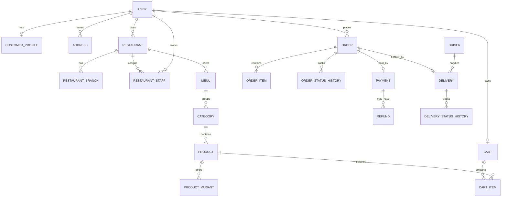

# Food Delivery & Logistics Platform API

FastAPI + SQLAlchemy backend starter for the Week 3 Backend Engineering assignment. It includes the 20 requested entity models, JWT authentication, role checks, product search/filtering, cart/order flow, order and delivery status histories, payments/refunds, driver assignment, tests, and a Postman starter collection.

> **Important:** This is an educational backend foundation, not a production payment system. Payment creation records a pending payment; it does not charge a real card or verify a mobile-money provider. Before production, add a real payment gateway, database migrations, rate limiting, structured logging, audit/security review, and stricter role/ownership rules.

## 1. Requirements
- Python 3.11+
- pip

## 2. Install and run
```bash
python -m venv .venv
# Windows:
.venv\Scripts\activate
# macOS/Linux:
source .venv/bin/activate
pip install -r requirements.txt
copy .env.example .env   # Windows; on macOS/Linux use: cp .env.example .env
uvicorn app.main:app --reload
```
Open Swagger UI at http://127.0.0.1:8000/docs and ReDoc at http://127.0.0.1:8000/redoc.

Set `SECRET_KEY` to a long random value in `.env`. SQLite is used by default; for PostgreSQL set `DATABASE_URL` to a suitable SQLAlchemy URL and install a PostgreSQL driver such as `psycopg[binary]`.

## 3. Authentication
Register a customer:
```http
POST /auth/register
Content-Type: application/json

{"full_name":"Ama Mensah","email":"ama@example.com","password":"StrongPassword123"}
```
Login uses OAuth2 form fields (`username` is the email):
```http
POST /auth/login
Content-Type: application/x-www-form-urlencoded

username=ama@example.com&password=StrongPassword123
```
Copy `access_token` and click **Authorize** in Swagger, entering `Bearer <token>` if prompted. Registration creates a CUSTOMER. Other roles should be assigned only by a trusted admin workflow; do not allow public role selection.

## 4. Main endpoints
| Method | Endpoint | Purpose |
|---|---|---|
| POST | `/auth/register` | Register customer |
| POST | `/auth/login` | Issue JWT |
| GET | `/auth/me` | Current account |
| POST/GET | `/restaurants` | Create/list restaurants |
| GET | `/restaurants/{restaurant_id}` | Restaurant details |
| POST | `/restaurants/{restaurant_id}/branches` | Add branch |
| POST | `/menus` / GET `/menus/{menu_id}` | Menu operations |
| POST/GET | `/categories` | Category operations |
| POST/GET | `/products` | Create/search products |
| GET | `/products/{product_id}` | Product details |
| POST/GET | `/product-variants` | Variant operations |
| POST/GET | `/cart/items`, GET `/cart` | Cart operations |
| PATCH/DELETE | `/cart/items/{item_id}` | Update/remove cart item |
| POST/GET | `/orders` | Create/list orders |
| GET | `/orders/{order_id}` | Order detail |
| PATCH | `/orders/{order_id}/status` | Transition order |
| GET | `/orders/{order_id}/status-history` | Order history |
| POST/GET | `/payments` | Create/get payment record |
| POST/GET | `/refunds` | Record/get refund |
| POST/GET | `/drivers` | Driver profiles |
| GET | `/deliveries` and `/deliveries/{delivery_id}` | Delivery listing/detail |
| POST | `/deliveries/{delivery_id}/assign-driver` | Assign driver |
| PATCH | `/deliveries/{delivery_id}/status` | Update delivery status |
| GET | `/deliveries/{delivery_id}/status-history` | Delivery history |
| GET/POST | `/customers/{customer_id}/addresses` | Customer addresses |

The full API contract is visible in Swagger after running the server. Search examples:
`GET /products?search=chicken&category_id=1&restaurant_id=1&min_price=20&max_price=100&available=true&page=1&limit=20`
`GET /restaurants?search=rice&location=Kumasi&active=true&page=1&limit=20&sort_by=name&order=asc`

## 5. Entity model overview (20)
1. User
2. Address
3. CustomerProfile
4. Restaurant
5. RestaurantBranch
6. RestaurantStaff
7. Menu
8. Category
9. Product
10. ProductVariant
11. Cart
12. CartItem
13. Order
14. OrderItem
15. OrderStatusHistory
16. Payment
17. Refund
18. Driver
19. Delivery
20. DeliveryStatusHistory

## 6. Order workflow
`PENDING → CONFIRMED → PREPARING → READY_FOR_PICKUP → OUT_FOR_DELIVERY → DELIVERED`
Cancellation is allowed only from `PENDING`, `CONFIRMED`, or `PREPARING`. Invalid transitions return HTTP 400. Order creation validates the cart and address, calculates item totals from current product prices, creates order items and status history, creates a delivery record, and clears the cart within a database transaction.

## 7. Roles
- `ADMIN`
- `RESTAURANT_OWNER`
- `STAFF`
- `CUSTOMER`
- `DRIVER`

Public registration only creates `CUSTOMER` accounts. To create an owner, staff member, admin, or driver, use a trusted seed/admin process. Do not expose arbitrary role updates to the public API.

## 8. Tests
```bash
pytest -q
```
Tests use a local SQLite test database. Add test cases for owner access, invalid transitions, cart isolation, order transactions, driver assignment, refunds, filters, and unauthorized access before submitting.

## 9. ER diagram (Mermaid)


## 10. Notes for assessment
- SQLAlchemy creates the tables automatically for this starter. For a team project, add Alembic migrations and commit migration files.
- Prices use floating point for readability in this starter; a real payment system should use `Decimal`/fixed-point numeric columns and explicit currency.
- The app does not include a production admin bootstrap endpoint by design. Seed privileged accounts through a controlled script or database migration.
- Review every route's permission checks and add stronger restaurant-level scoping where your lecturer expects it.
